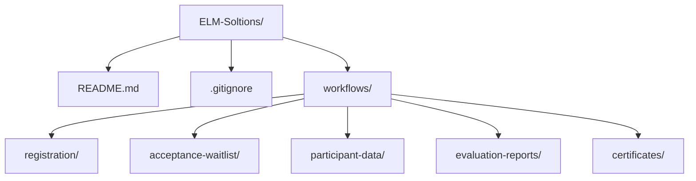

# ELM-Soltions

مستودع فريق علم لتنظيم تطوير أتمتة أعمال الفعاليات باستخدام n8n Community.

**الحالة الحالية:** هيكل تأسيسي جاهز لتوزيع العمل. ملفات `workflow.json` قوالب فارغة وغير مفعّلة؛ الأنظمة الخمسة لم تُنفّذ بعد.

## الأنظمة المعتمدة

| النظام | المجلد داخل workflows | الحالة |
|---|---|---|
| [إدارة التسجيل](workflows/registration/) | `registration/` | لم يبدأ التنفيذ |
| [إدارة المقبولين وقائمة الانتظار](workflows/acceptance-waitlist/) | `acceptance-waitlist/` | لم يبدأ التنفيذ |
| [تجهيز بيانات المشاركين](workflows/participant-data/) | `participant-data/` | لم يبدأ التنفيذ |
| [التقييم والتقارير](workflows/evaluation-reports/) | `evaluation-reports/` | لم يبدأ التنفيذ |
| [إصدار الشهادات](workflows/certificates/) | `certificates/` | لم يبدأ التنفيذ |

## هيكل المستودع

داخل كل مجلد نظام:

- `README.md`: الهدف والمدخلات والمخرجات وخطوات التطوير وحالات التحقق والمسؤول والمراجع.
- `workflow.json`: قالب فارغ للبدء؛ يُستبدل بالتصدير الفعلي من n8n بعد التطوير.

## طريقة عمل الفريق

1. يطوّر كل عضو على نسخة n8n Community المحلية لديه.
2. يُحدد مسؤول ومراجع لكل نظام في ملفه `README.md`.
3. ينشئ العضو فرعًا باسم واضح، مثل `feature/registration`، ويعمل على مجلد نظامه.
4. يختبر الأتمتة ببيانات تجريبية ويحدّث توثيق الإعداد والتشغيل.
5. يصدّر ملف JSON ويرفعه مع التوثيق، ثم يفتح Pull Request.
6. بعد المراجعة، تُدمج النسخة المعتمدة في `main`.
7. يستورد مسؤول التشغيل النسخة المعتمدة إلى n8n الرئيسي، ويربط حسابات النادي ويختبرها قبل تفعيلها.

النقل بين GitHub وn8n يتم بالتصدير والاستيراد يدويًا. رفع الملفات إلى هذا المستودع لا يشغّل الأتمتة تلقائيًا.

## الربط بين الأنظمة

هذه اتفاقية مقترحة للحقول المشتركة، يثبتها الفريق قبل التنفيذ:

| الحقل | الاستخدام |
|---|---|
| `event_id` | معرّف الفعالية. |
| `participant_id` | معرّف المشارك. |
| `full_name` | اسم المشارك كما سيظهر في المخرجات. |
| `email` | بريد المشارك. |

تُستخدم معرفات مشتركة لربط ردود النماذج وحالات القبول والبيانات والشهادات. يعتمد إصدار الشهادات على قائمة الحاضرين المستحقين المعتمدة، ويحتاج التقييم إلى قائمة الحاضرين؛ آلية تسجيل الحضور تُحدد عند التنفيذ.

## إعداد الخدمات والبيانات

- تُحفظ Credentials داخل n8n، ويُوثق في المستودع نوع كل خدمة والإعداد المطلوب دون القيم السرية.
- تستخدم ملفات التجربة بيانات وهمية؛ تحفظ بيانات المشاركين الفعلية في مصدر البيانات المعتمد للنادي.
- قبل التصدير تُزال البيانات المثبتة `pinData` وأي أسرار مكتوبة داخل إعدادات Nodes.
- توقيت التشغيل المتفق عليه هو `Asia/Riyadh`.
- عند إعادة المحاولة يجب ألا تتكرر رسائل القبول أو الشهادات أو حجز المقاعد لنفس الحدث.

## التوثيق عند التسليم

يحدّث مسؤول النظام ملفه `README.md` ليحتوي على الخدمات المرتبطة، أسماء الحقول، إعدادات التشغيل، نتائج التحقق، وأي نقاط تحتاج متابعة.
